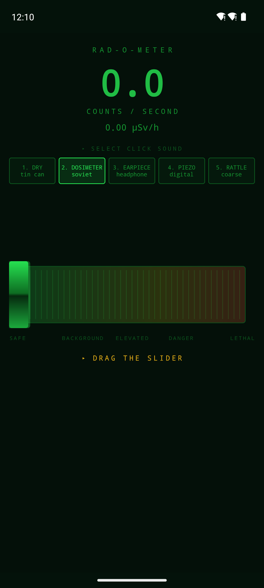
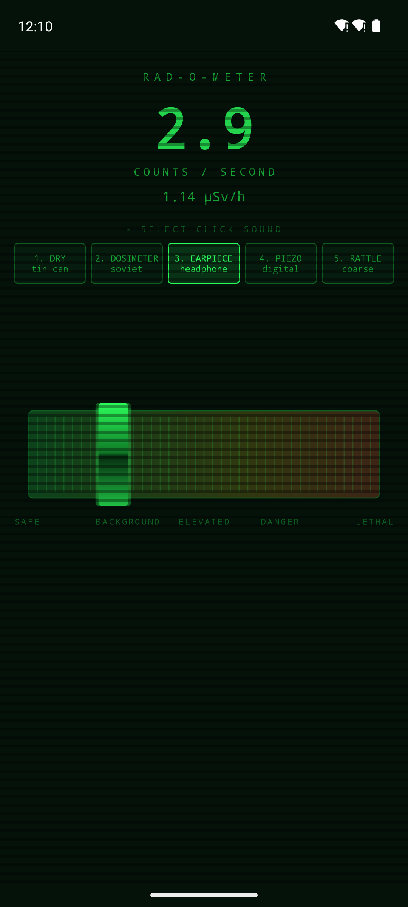
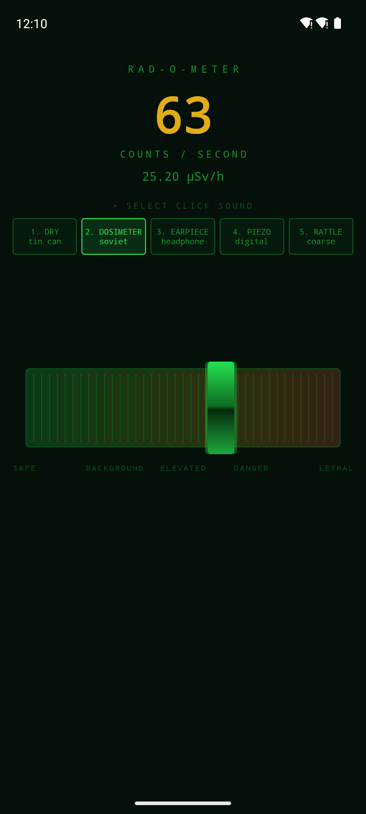
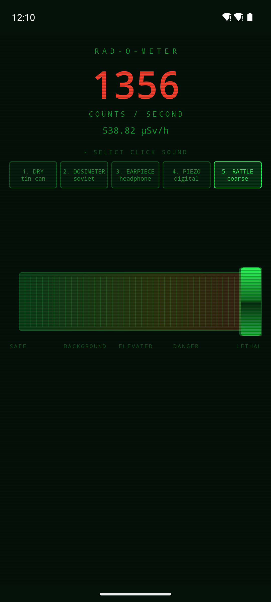

# ☢ Rad-O-Meter

**A Geiger counter that measures absolutely nothing.** Drag the slider and listen to
the room go from dead silent to lethal — from a lonely tick every few seconds to an
ugly roar at 1400 counts per second. No radiation involved. Just sound.

<p align="center">
  
  
  
  
</p>

---

## What this is

A little toy instrument for Android. One wide slider across the screen, a green CRT
panel, and five different click sounds you can switch between while it is running.
Good for spooking people in the dark, laying under a film scene, or just fiddling
with because it is oddly satisfying to hear the decay climb.

The app is 32 kB, asks for **zero permissions**, and ships **no audio files at all**.
Every click is computed from scratch when the app starts.

## The sounds

Five characters, all built on the same model — a voltage spike excites three
resonators that ring down. What separates them is the kind of instrument you
imagine: how big the box is, whether the speaker sits in a bakelite case or an
earpiece, how hard the output stage is driven.

| # | Sound | Character | Audible length |
|---|-------|-----------|----------------|
| 1 | **DRY** | small cheap tin can, thin and snappy | 4.0 ms |
| 2 | **DOSIMETER** | soviet, hollow bakelite ring | 11.4 ms |
| 3 | **EARPIECE** | headphone, clean and short "tk" | 2.0 ms |
| 4 | **PIEZO** | modern digital meter, rings tonally | 8.1 ms |
| 5 | **RATTLE** | coarse and dirty, becomes a roar at the top | 6.8 ms |

## Why it sounds real

What gives away a bad Geiger simulation is that it ticks evenly. Real radioactive
decay is random — atoms do not check with each other first. The number of decays in
a time window follows a **Poisson distribution**, so for every 10 millisecond block
the engine draws a random count from that distribution and scatters the clicks at
random sample positions.

The result is clusters and gaps, exactly like the real thing. Measured on the
finished build, the variance-to-mean ratio comes out at 1.06 — a true Poisson
process sits at 1.0.

Clicks are mixed sample by sample straight into an `AudioTrack` buffer in
low-latency mode, rather than stacked as separate playbacks. That keeps the timing
honest all the way up to 1400 counts per second, for about 1.7 % of one CPU core.

## Install

Grab the latest APK from [**Releases**](../../releases) and open it on your phone.
Android will ask permission to install from an unknown source — expected for an app
that does not come from the Play Store.

With a cable and USB debugging enabled it also works like this:

```bash
adb install RadOMeter-1.0.apk
```

Requires Android 7.0 or later.

## Build it yourself

```bash
cd android
./gradlew assembleDebug
```

The APK lands in `android/app/build/outputs/apk/debug/`. For a release build, drop
your own `keystore.properties` into `android/` with `storeFile`, `storePassword`,
`keyAlias` and `keyPassword` — that file and the keystore itself are deliberately
kept out of git.

## Layout

```
android/                      the app
  app/src/main/java/se/william/radometer/
    GeigerEngine.kt           synthesis, Poisson scheduling, the AudioTrack mixer
    RadSlider.kt              the slider, drawn by hand
    MainActivity.kt           the panel and the lifecycle
poc/index.html                the web version this all started as
docs/                         screenshots
```

`poc/index.html` is standalone — open it in any browser and you get the same five
sounds through Web Audio, with keys 1–5 to switch between them.

## Hardly needs saying

This app measures nothing. It has no sensor, reads no surroundings, and has no idea
whether you are standing in a basement or in Pripyat. The µSv/h figures are invented
and derived straight from the slider position. **Never use it for anything to do with
actual radiation safety.**
