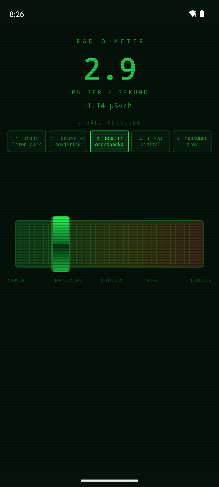
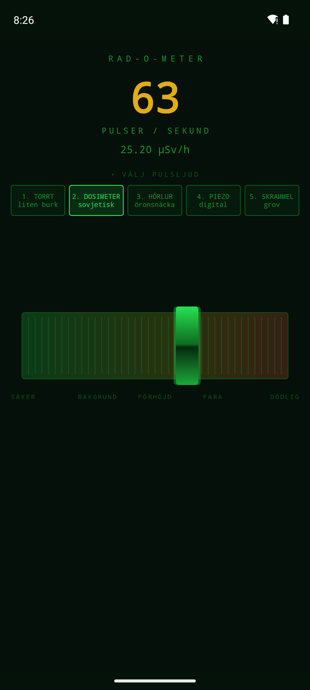
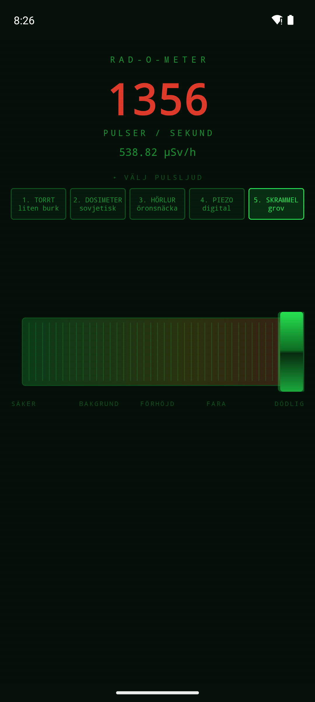

# ☢ Rad-O-Meter

**En geigermätare som inte mäter någonting.** Dra i reglaget och hör rummet gå från
knäpptyst till dödligt — från ett ensamt tick i minuten till ett obehagligt vrål på
1400 pulser i sekunden. Ingen strålning inblandad, bara ljud.

<p align="center">
  
  
  
  
</p>

---

## Vad är det här

Ett litet leksaksinstrument för Android. Ett brett reglage tvärs över skärmen, en
grön bildrörspanel, och fem olika pulsljud du byter mellan medan det låter. Perfekt
att skrämma folk med i mörkret, lägga bakom en filmscen, eller bara pilla med för
att det är märkligt tillfredsställande att höra sönderfallet klättra.

Appen är 32 kB, begär **noll behörigheter** och innehåller **inga ljudfiler**.
Varje knäpp räknas fram från grunden när appen startar.

## Ljuden

Fem karaktärer, alla byggda på samma modell — en spänningsspik exciterar tre
resonatorer som klingar av. Det som skiljer dem åt är vilken sorts apparat man
tänker sig: hur stor lådan är, om högtalaren sitter i en bakelitburk eller i ett
öronskal, hur hårt slutsteget drivs.

| # | Ljud | Karaktär | Hörbar längd |
|---|------|----------|--------------|
| 1 | **TORRT** | liten billig burk, tunt och snärtigt | 3,9 ms |
| 2 | **DOSIMETER** | sovjetisk, hålig bakelitklang | 7,6 ms |
| 3 | **HÖRLUR** | öronsnäcka, rent och kort "tk" | 2,0 ms |
| 4 | **PIEZO** | modern digital mätare, ringer tonalt | 8,3 ms |
| 5 | **SKRAMMEL** | grov och smutsig, blir ett vrål i toppen | 7,3 ms |

## Hur det låter äkta

Det som avslöjar en dålig geigersimulering är att den tickar jämnt. Riktigt
radioaktivt sönderfall är slumpmässigt — atomerna hör inte av sig till varandra
först. Antalet sönderfall under ett tidsfönster följer en **poissonfördelning**, så
för varje 10-millisekundersblock drar motorn ett slumptal ur den fördelningen och
placerar pulserna på slumpade sampelpositioner.

Resultatet: klungor och luckor, precis som i verkligheten. Uppmätt på det färdiga
bygget blir kvoten varians/medelvärde 1,06 — en äkta poissonprocess ligger på 1,0.

Pulserna mixas sampel för sampel rakt ned i en `AudioTrack`-buffert i låglägesläge,
inte som staplade uppspelningar. Därför håller timingen hela vägen upp till 1400
pulser i sekunden, för ungefär 1,7 % av en processorkärna.

## Installera

Hämta senaste APK-filen under [**Releases**](../../releases) och öppna den på
telefonen. Android frågar om lov att installera från okänd källa — det är
förväntat för en app som inte kommer från Play Store.

Med kabel och USB-felsökning påslagen går det också så här:

```bash
adb install RadOMeter-1.0.apk
```

Kräver Android 7.0 eller senare.

## Bygga själv

```bash
cd android
./gradlew assembleDebug
```

APK:n hamnar i `android/app/build/outputs/apk/debug/`. Behöver du ett
release-bygge lägger du en egen `keystore.properties` i `android/` med
`storeFile`, `storePassword`, `keyAlias` och `keyPassword` — den och själva
nyckellagret hålls medvetet utanför git.

## Innehåll

```
android/                      appen
  app/src/main/java/se/william/radometer/
    GeigerEngine.kt           ljudsyntes, poissonschema, AudioTrack-mixern
    RadSlider.kt              reglaget, ritat för hand
    MainActivity.kt           panelen och livscykeln
poc/index.html                webbversionen som allt började med
docs/                         skärmbilder
```

`poc/index.html` är en fristående sida — öppna den i valfri webbläsare och du får
samma fem ljud via Web Audio, med tangenterna 1–5 för att växla mellan dem.

## Det behöver knappast sägas

Appen mäter ingenting. Den har ingen sensor, läser ingen omgivning och vet inte om
du står i en källare eller i Pripjat. Siffrorna i µSv/h är påhittade och räknas
rakt av från reglagets läge. **Använd den aldrig till någonting som rör riktig
strålsäkerhet.**
